<div align="center">

<picture>
  <source media="(prefers-color-scheme: light)" srcset="docs/assets/banner-light-en.png">
  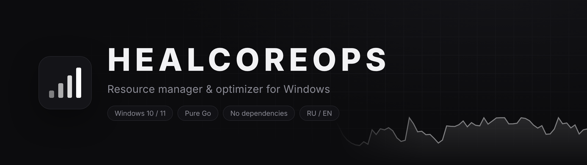
</picture>

**Monitoring, cleanup, tweaks and diagnostics for Windows in one app — for everyday users and sysadmins.**

[](https://github.com/healcore/healcoreops/releases/latest)
[](https://github.com/healcore/healcoreops/releases)
[](https://github.com/healcore/healcoreops/actions)


[](LICENSE)

[Русский](README.md) · **English**

[**⬇ Download**](https://github.com/healcore/healcoreops/releases/latest/download/HealCoreOps-Setup.exe) ·
[Features](#features) ·
[For sysadmins](#for-system-administrators) ·
[Security](#security) ·
[Building](#building-from-source)

<br>

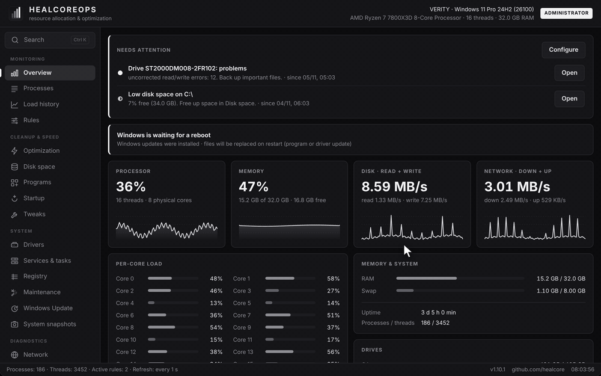

</div>

<br>

## Why

Usually this takes a dozen tools: Task Manager, Disk Cleanup, an uninstaller, a tweaker, a BSOD viewer,
a service manager and admin scripts. **HealCoreOps** is a single lightweight app (~14 MB, no dependencies)
with all of that in a calm monochrome UI — and **every system change is recorded and can be undone in one click**.

- 🩺 **One-click PC checkup** — finds junk, blue screens, disabled protection, devices without drivers, a worn SSD, and explains what to do.
- 🧹 **Cleans what is safe to clean** — caches, temp files, update downloads; files only go to the Recycle Bin.
- ⚙️ **58 vetted Windows tweaks** and built-in app removal — every tweak is reversible.
- 🛠 **For admins** — command line, silent install, registry policies, Windows Event Log auditing.
- ↩️ **Change history** — everything the app changed is visible and revertible.

The interface is available in **English and Russian** (switch in Settings).

## Installation

1. Download **[HealCoreOps-Setup.exe](https://github.com/healcore/healcoreops/releases/latest/download/HealCoreOps-Setup.exe)** from the [latest release](https://github.com/healcore/healcoreops/releases/latest).
2. Run it → Install. No admin rights are needed to install.
3. For tweaks and services click **Restart as administrator** in the app.

> [!NOTE]
> Windows SmartScreen may warn about an unknown publisher — release signing is being set up
> ([how it works](docs/SIGNING.md)). Click “More info” → “Run anyway”.
> The source is open and releases are built by GitHub Actions from this repository.

Running the installer again updates the app and keeps your settings. Uninstall via Settings → Apps → HealCoreOps.

## Features

| | |
|---|---|
| **PC checkup** | Load, junk, protection, blue screens, app crashes, drivers, disk and battery health, startup, pending reboot — each finding links to a fix |
| **Load history** | CPU and memory for 3 h – 7 days; hover the chart to see which processes loaded the PC at that moment (“what was slow yesterday at 2 pm”) |
| **Hardware health** | Drive SMART (wear, temperature, power-on hours, read/write errors), battery wear and cycles, NVIDIA GPU temperature, fan and power draw |
| **Disk space** | **Duplicate finder** by content (SHA-256), largest folders and files with drill-down, browser caches, Windows Update downloads, temp files, error reports, shader caches; system paths are protected; deletions go to the Recycle Bin and can be undone; **scheduled cleanup** |
| **Programs** | All installed programs, uninstall, silent bulk uninstall, leftover finder, updates via winget |
| **Crashes & errors** | Blue screens from dumps and logs **with a decoded code and advice**, unexpected shutdowns, app crashes and hangs, frequent log errors |
| **Tweaks** | 58 tweaks in 10 groups and removal of ~45 built-in apps, “apply recommended”, restore point, side-effect warnings |
| **Services & tasks** | Services (third-party filter, startup type, start/stop) and Task Scheduler; vital services are protected |
| **Network** | Internet check with a verdict, adapters, ping, port check, traceroute; **per-program connections** with host names; **open ports** — who can reach them and whether the firewall lets them through |
| **Windows Update** | Available updates with selective install, install history **with decoded error codes**, pause for 7–35 days with undo |
| **System snapshots** | Take a “before” snapshot and compare with now: what was added to programs, startup, services, tasks, drivers and open ports |
| **Report & security** | Antivirus, firewall, BitLocker, updates, UAC, Secure Boot, SMBv1, RDP; boot time and what slows it; HTML/JSON computer report |
| **History** | Every change with an Undo button, plus the action log |
| **Simple mode** | New installs show only the essentials; all sections are one click (or Ctrl+K) away |
| **Also** | Live overview, processes and priority rules, drivers from official sources, registry healer with `.reg` backups, maintenance (SFC, DISM, Winsock, DNS), **Ctrl+K** command palette, game mode, tray mode with quick actions, profile export/import, dark & light themes |

<details>
<summary><b>More screenshots</b></summary>

<br>

| | |
|---|---|
| 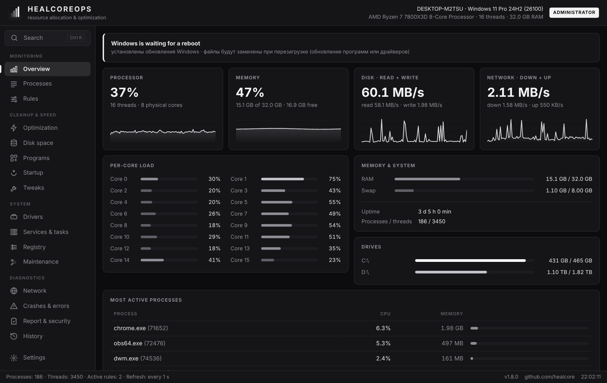<br><sub>Overview in English</sub> | 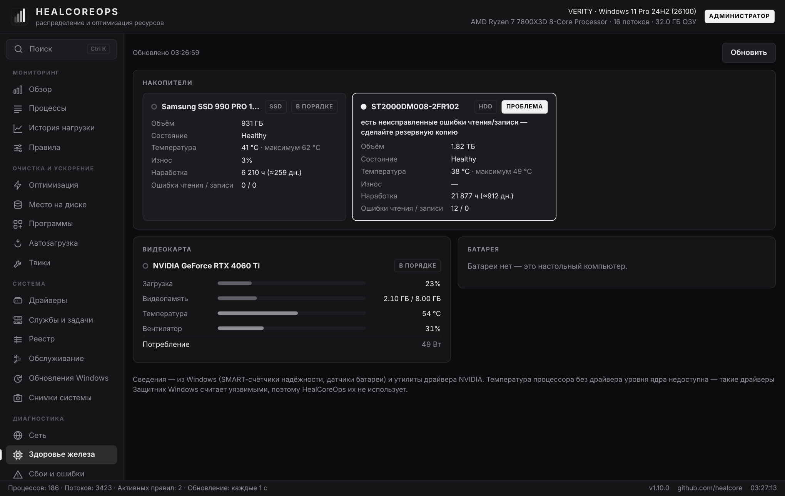<br><sub>Hardware health</sub> |
| 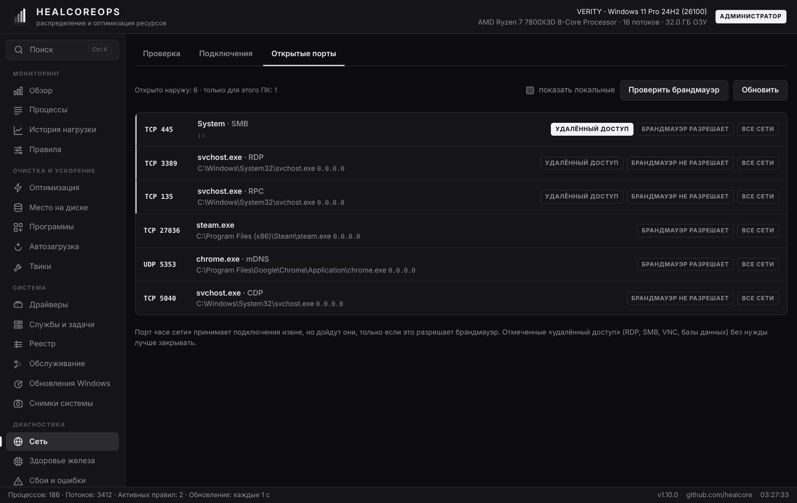<br><sub>Open ports and firewall check</sub> | 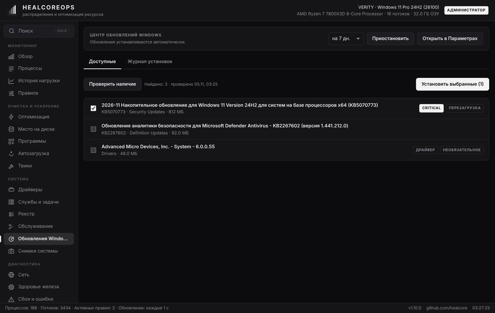<br><sub>Windows Update</sub> |
| 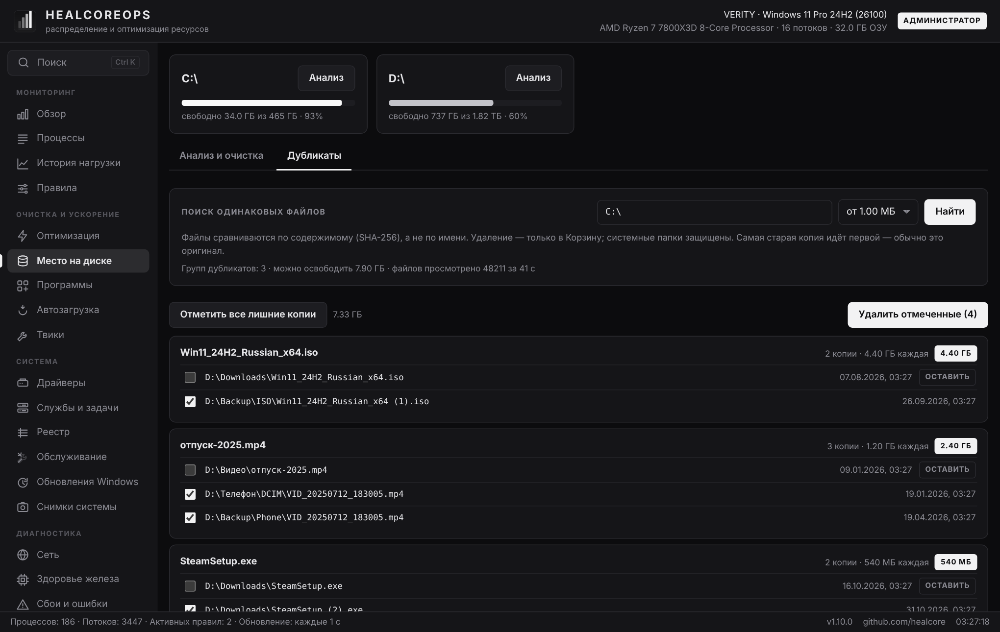<br><sub>Duplicate files</sub> | 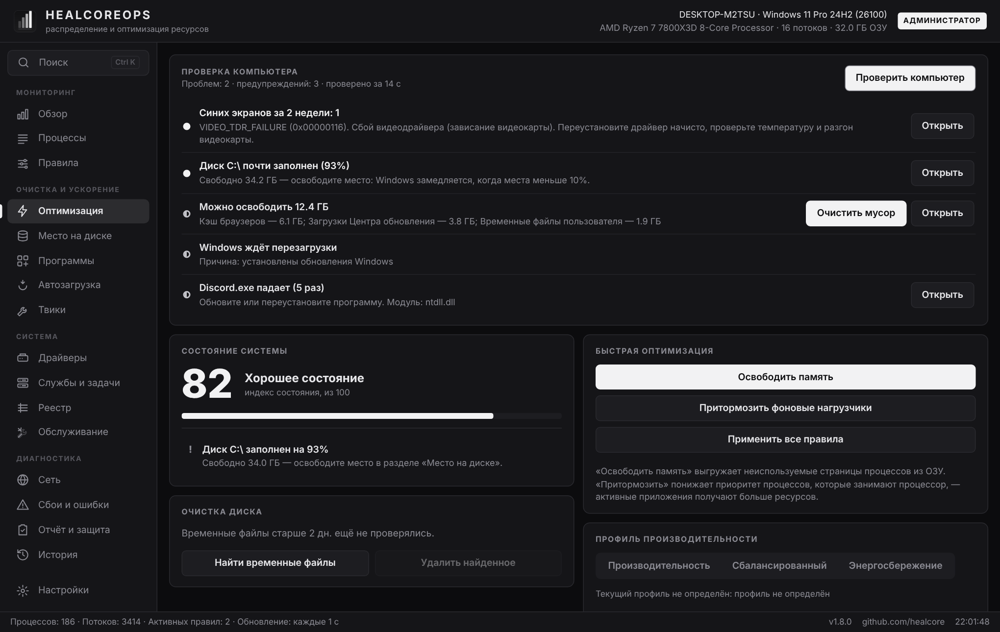<br><sub>PC checkup</sub> |
| 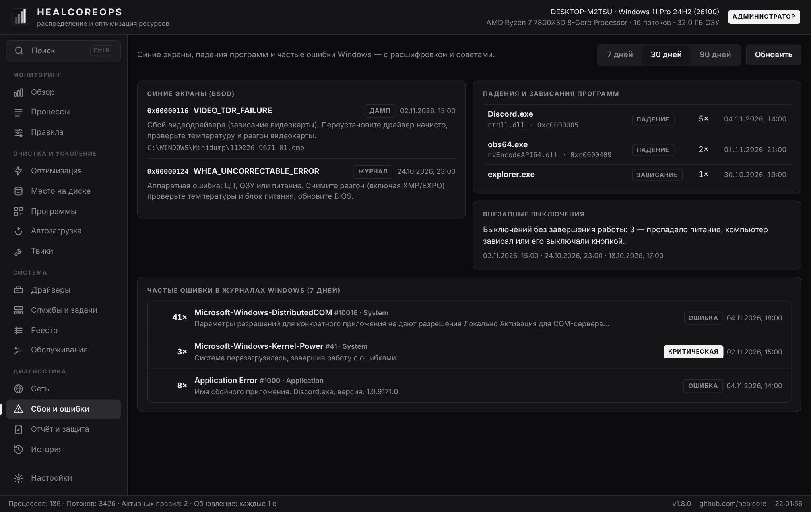<br><sub>Crashes & errors</sub> | 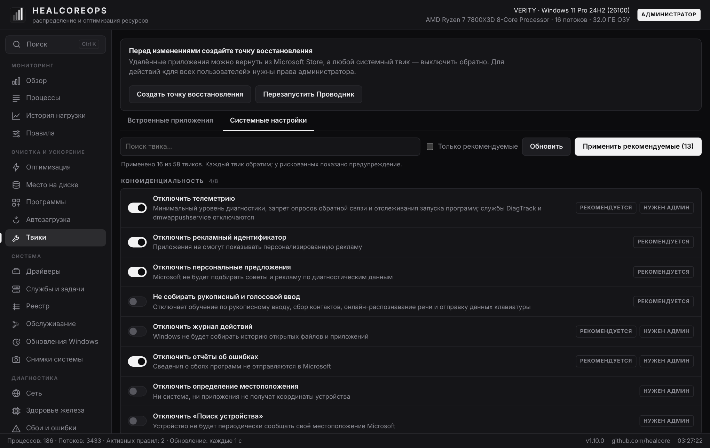<br><sub>Tweaks</sub> |
| 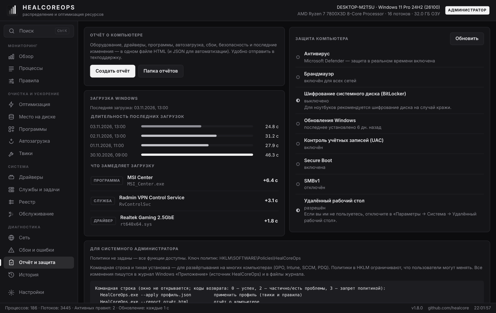<br><sub>Report, inventory, support bundle</sub> | 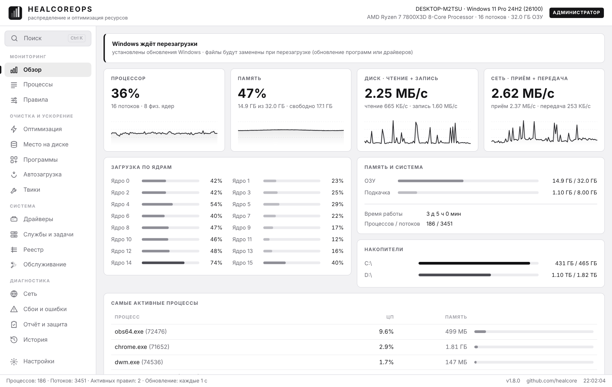<br><sub>Light theme</sub> |

</details>

## For system administrators

**Silent install** (GPO, Intune, SCCM, PDQ):

```bat
HealCoreOps-Setup.exe /S [/ALLUSERS] [/NODESKTOP] [/NOSTARTMENU] [/LAUNCH] [/LOG=setup.log] [/D=C:\Path]
uninstall.exe /uninstall /S [/PURGE]
```

`/ALLUSERS` installs to Program Files with shortcuts for all users (admin required). Exit codes: `0` success, `1` error, `5` admin required.

**Command line** (no window opens; use `start /wait` in cmd, `Start-Process -Wait` in PowerShell):

```bat
HealCoreOps.exe --apply profile.json [--prefs]   :: apply a profile (tweaks and rules)
HealCoreOps.exe --export-profile profile.json    :: save the current profile
HealCoreOps.exe --report [report.html|.json]     :: computer report
HealCoreOps.exe --checkup [--json result.json]   :: PC checkup
HealCoreOps.exe --inventory \\srv\inv\%COMPUTERNAME%.json  :: inventory (.json — everything, .csv — one row in a shared fleet table)
HealCoreOps.exe --support-bundle [path.zip]      :: support bundle: report, logs, history (no personal files)
HealCoreOps.exe --clean                          :: quick cleanup
HealCoreOps.exe --maintenance sfc                :: maintenance (--list-maintenance)
HealCoreOps.exe --tweak telemetry=on             :: tweaks (--list-tweaks)
:: common: --log file.txt, --quiet
```

Exit codes: `0` success, `1` error, `2` partial / problems found, `3` blocked by policy, `64` bad arguments.

**Fleet inventory without a server.** `--inventory` with a `.csv` path appends this PC's row to a shared table
(the same PC's row is replaced; concurrent writes from many machines are lock-protected). Run it via Group Policy to get
a summary: OS, hardware, free space, worst drive, battery wear, pending reboot, security issues, last update, failed updates,
exposed remote-access ports and active alerts.

**Alerts for monitoring.** While the app runs (including in the tray) it checks thresholds every 2 minutes: low disk space,
drive SMART errors and wear, drive and GPU overheating, memory full for 10+ minutes, battery wear, pending reboot and stopped
watched services. A new alert shows a notification and writes to the **Application** log, source `HealCoreOps`:
`2000` — warning, `2001` — problem (changes made by the app use `1000`). Collect them with Zabbix, PRTG, Wazuh or Windows Event Forwarding.

**Policies** — `HKLM\SOFTWARE\Policies\HealCoreOps`: `ReadOnly`, `DisableTweaks`, `DisableDefenderTweak`,
`DisableRegistryHealer`, `DisableProgramChanges`, `DisableServiceChanges`, `DisableDiskCleanup`, `DisableDriverInstall`,
`DisableUpdateCheck`, `LockSettings` (DWORD), `HideSections`, `EnforcedProfile` (string).
They are enforced by the app core, not just the UI. A `.reg` template is saved from **Report & security**.
On Linux/macOS use `/etc/healcoreops/policy.json`.

**Auditing.** Every change goes to the Windows Application log (source `HealCoreOps`, event 1000),
to the app history and to `%APPDATA%\HealCoreOps\logs\healcoreops-YYYY-MM.log`.

## Security

- The UI is served only on `127.0.0.1` and requires a random token generated at each start.
- The app **never downloads or runs** anything from third-party sites: drivers and app updates are installed via **winget**
  (publishers' official sources with checksum verification), otherwise the vendor's official page is opened.
  The app never updates itself silently — it only notifies you about a new version.
- Files go to the Recycle Bin, registry changes are backed up to `.reg`, system folders and vital services are protected.
- **Deliberately not included:** disabling UAC or Windows Update, removing Edge, disabling IPv6.

> [!WARNING]
> Disabling Microsoft Defender is available but marked as dangerous and is not part of “recommended”.
> On Windows 11 you must turn off Tamper Protection manually first. The same switch turns protection back on.

Found a vulnerability? See [SECURITY.md](SECURITY.md).

Tweaks were compiled by studying open-source Windows optimization projects —
[WinUtil](https://github.com/ChrisTitusTech/winutil), [Win11Debloat](https://github.com/Raphire/Win11Debloat),
[Optimizer](https://github.com/hellzerg/optimizer), [Sophia Script](https://github.com/farag2/Sophia-Script-for-Windows) —
and then filtered down to safe, reversible ones.

## Linux & macOS

Tweaks, drivers, services and crash logs are Windows-only. Monitoring, processes, rules, disk analysis,
network, reports and the command line work everywhere:

```sh
./healcoreops-linux-amd64          # the UI opens in your browser
```

## Building from source

Only **Go 1.24+** is required — no C compiler (pure Go, WebView2 is called directly), so the Windows installer builds on any OS.

```sh
git clone https://github.com/healcore/healcoreops && cd healcoreops
./build.sh       # Linux/macOS → dist/HealCoreOps-Setup.exe and dist/healcoreops-linux-amd64
build.bat        # Windows    → dist\HealCoreOps-Setup.exe
```

See [CONTRIBUTING.md](CONTRIBUTING.md) and [CHANGELOG.md](CHANGELOG.md).

## Code signing & privacy

[Code signing policy](docs/CODE_SIGNING_POLICY.md) · [how releases are signed](docs/SIGNING.md).
No telemetry. On its own the app only contacts GitHub once a day to read the latest version number
(can be turned off in Settings). Everything else happens only on your action: driver lookup,
Windows Update, network checks. Details are in the policy.

## License

[MIT](LICENSE) © healcore
