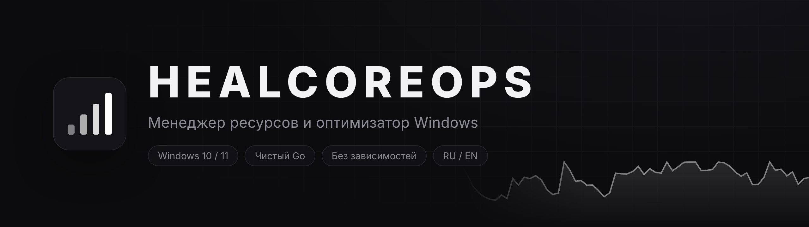
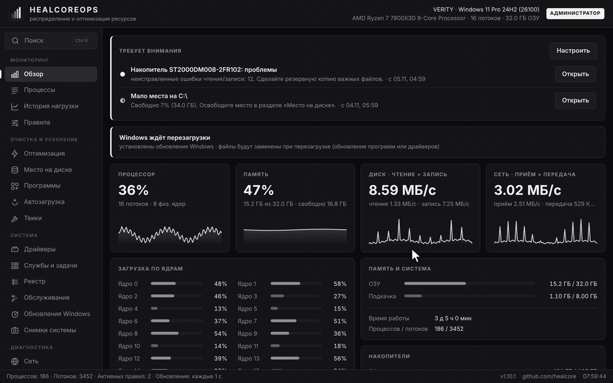
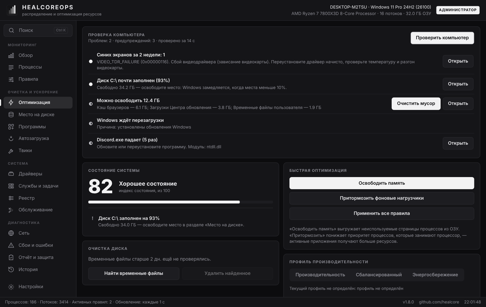
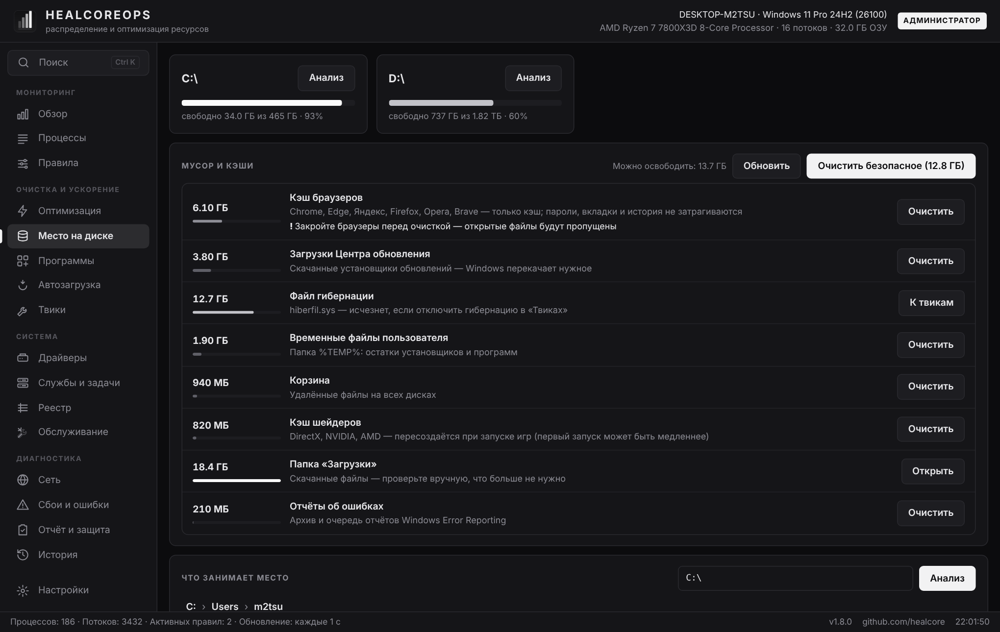
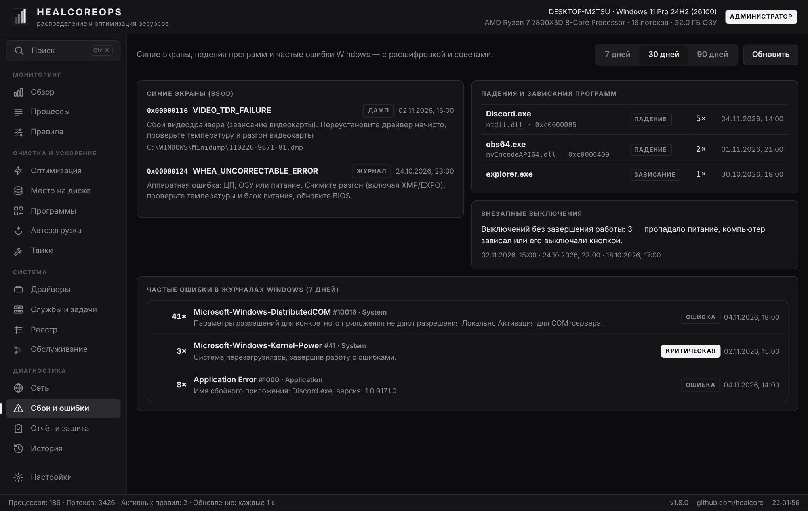
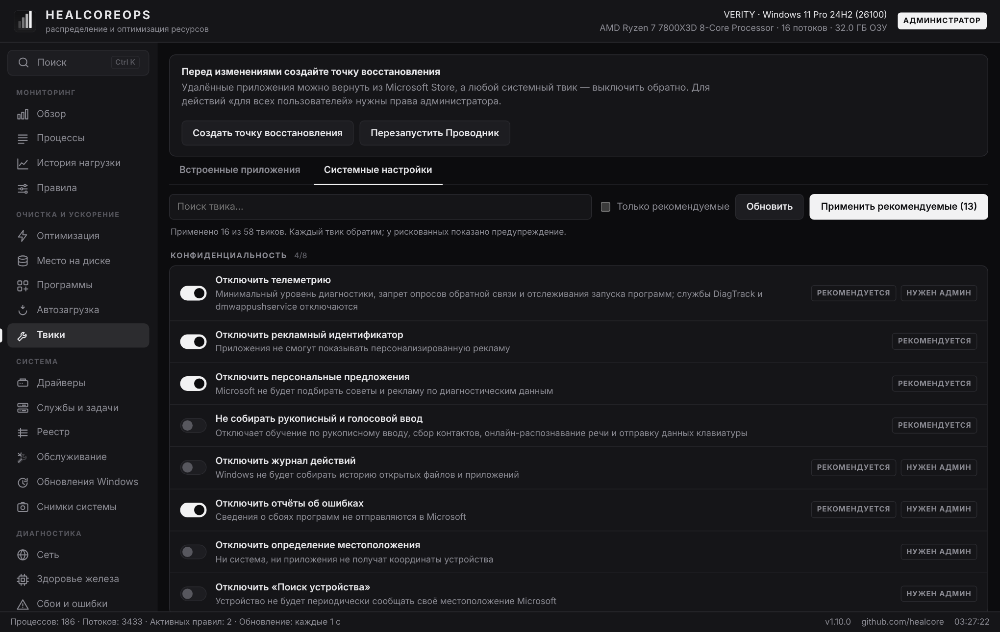
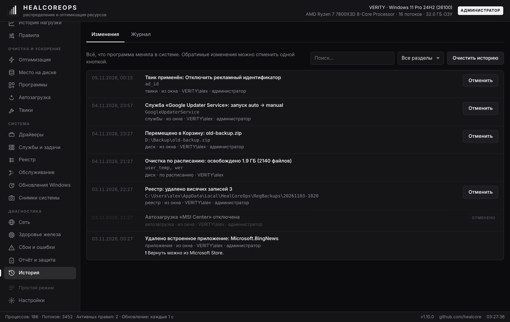
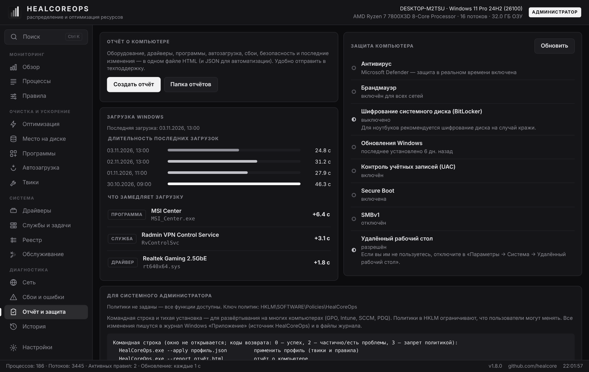
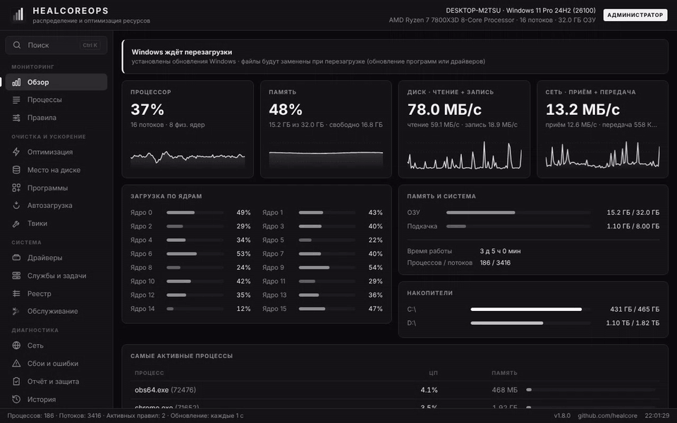

<div align="center">

<picture>
  <source media="(prefers-color-scheme: light)" srcset="docs/assets/banner-light.png">
  
</picture>

**Мониторинг, очистка, твики и диагностика Windows в одной программе — для обычных пользователей и системных администраторов.**

[](https://github.com/healcore/healcoreops/releases/latest)
[](https://github.com/healcore/healcoreops/releases)
[](https://github.com/healcore/healcoreops/actions)


[](LICENSE)

**Русский** · [English](README.en.md)

[**⬇ Скачать**](https://github.com/healcore/healcoreops/releases/latest) ·
[Возможности](#возможности) ·
[Для администраторов](#для-системного-администратора) ·
[Безопасность](#безопасность) ·
[Сборка](#сборка-из-исходников)

<br>



</div>

<br>

## Зачем

Обычно для этого нужен десяток утилит: диспетчер задач, «очистка диска», деинсталлятор,
твикер, просмотрщик синих экранов, менеджер служб, скрипты для администраторов.
**HealCoreOps** — одно лёгкое приложение (~14 МБ, без зависимостей), где всё это собрано
в спокойном монохромном интерфейсе, а каждое изменение системы **записывается и отменяется одной кнопкой**.

- 🩺 **Проверка ПК в один клик** — найдёт мусор, синие экраны, отключённую защиту, устройства без драйверов, изношенный SSD и объяснит, что делать.
- 🧹 **Чистит то, что можно чистить** — кэши, временные файлы, загрузки обновлений; файлы удаляются только в Корзину.
- ⚙️ **58 проверенных твиков** Windows и удаление встроенных приложений — каждый твик обратим.
- 🛠 **Для администраторов** — командная строка, тихая установка, политики в реестре, журнал событий для аудита.
- ↩️ **История изменений** — всё, что программа меняла, видно и откатывается.

## Установка

1. Скачайте **[HealCoreOps-Setup.exe](https://github.com/healcore/healcoreops/releases/latest)** из последнего релиза.
2. Запустите → «Установить». Права администратора для установки не нужны.
3. Для твиков и служб нажмите в окне **«Перезапустить от имени администратора»**.

> [!NOTE]
> Windows SmartScreen может предупредить о неизвестном издателе — exe пока не подписан сертификатом.
> Нажмите «Подробнее» → «Выполнить в любом случае». Исходный код открыт, сборки делаются GitHub Actions из этого репозитория.

Повторный запуск установщика обновляет программу с сохранением настроек.
Удаление — «Параметры → Приложения → HealCoreOps».

## Возможности

<table>
<tr>
<td width="50%" valign="top">

### 🩺 Проверка ПК
Нагрузка, мусор, защита, синие экраны, падения программ, драйверы, здоровье дисков и батареи,
автозагрузка, ожидающая перезагрузка. У каждой находки — кнопка «Открыть» или быстрое исправление.

</td>
<td width="50%"></td>
</tr>
<tr>
<td></td>
<td valign="top">

### 💽 Место на диске
Самые большие папки и файлы с переходом вглубь, кэши браузеров, загрузки Центра обновления,
временные файлы, отчёты об ошибках, кэш шейдеров. Системные папки защищены, удаление — в Корзину
с откатом из «Истории». Можно настроить **автоочистку по расписанию**.

</td>
</tr>
<tr>
<td valign="top">

### 💥 Сбои и ошибки
Синие экраны из дампов и журнала **с расшифровкой кода и советом** (VIDEO_TDR_FAILURE → видеодрайвер,
WHEA_UNCORRECTABLE_ERROR → разгон/питание…), внезапные выключения, падения и зависания программ,
частые ошибки журналов Windows.

</td>
<td></td>
</tr>
<tr>
<td></td>
<td valign="top">

### 🔧 Твики и встроенные приложения
58 твиков в 10 группах (конфиденциальность, реклама, ИИ-функции, панель задач, проводник,
производительность, игры…) и удаление ~45 встроенных приложений. «Применить рекомендуемые»,
точка восстановления, предупреждения о побочных эффектах.

</td>
</tr>
<tr>
<td valign="top">

### ↩️ История изменений
Всё, что программа меняла в системе, — с кнопкой «Отменить»: твики, автозагрузка, службы, задачи,
питание, реестр, файлы в Корзине. Изменения из командной строки и по расписанию тоже здесь.

</td>
<td></td>
</tr>
<tr>
<td></td>
<td valign="top">

### 🛡 Отчёт и защита
Антивирус, брандмауэр, BitLocker, обновления, UAC, Secure Boot, SMBv1, RDP;
время загрузки Windows и что её замедляет; **отчёт о компьютере** в HTML и JSON — удобно отправить в техподдержку.

</td>
</tr>
</table>

<details>
<summary><b>Все разделы</b></summary>

<br>

| Раздел | Что делает |
|---|---|
| Обзор | ЦП, память, диск, сеть с живыми графиками; загрузка каждого ядра; накопители; самые активные процессы; **оповещения**, требующие внимания |
| История нагрузки | ЦП и память за 3 ч – 7 дней; наведите на график — видно, какие процессы нагружали ПК в этот момент («что тормозило вчера в 14:00») |
| Процессы | Поиск, сортировка; приоритет, привязка к ядрам, приостановка, завершение |
| Правила | «Процесс → приоритет + ядра», шаблоны `chrome*`, автоприменение к новым процессам |
| Оптимизация | Проверка ПК, многофакторный индекс состояния, освобождение памяти, профиль питания, автоочистка по расписанию |
| Место на диске | Анализ папок и файлов, мусор и кэши, **поиск дубликатов** по содержимому (SHA-256), удаление в Корзину |
| Программы | Все установленные программы, удаление, тихое пакетное удаление, поиск остатков, обновление через winget |
| Автозагрузка | Программы, стартующие с Windows, — вкл/выкл; скорость загрузки и что её замедляет |
| Твики | 58 системных твиков и удаление встроенных приложений |
| Драйверы | Плата, процессор, видеокарта, сеть, звук; проверка и установка в фоне: NVIDIA — с nvidia.com с проверкой подписи, остальные — пакеты производителей из каталога Windows Update |
| Службы и задачи | Службы (фильтр «только сторонние», тип запуска, запуск/остановка) и Планировщик заданий; жизненно важные службы защищены |
| Реестр | Осторожный поиск «висячих» записей с резервной копией `.reg` |
| Обслуживание | SFC, DISM, сброс Центра обновления, Winsock, DNS (Cloudflare / Google / Quad9) — с выводом в реальном времени |
| Обновления Windows | Доступные обновления с выборочной установкой, журнал установок **с расшифровкой кодов ошибок**, пауза на 7–35 дней с откатом |
| Снимки системы | Снимок «до» и сравнение с текущим состоянием: что добавилось в программы, автозагрузку, службы, задачи, драйверы и открытые порты |
| Сеть | Проверка интернета с вердиктом, адаптеры, пинг, проверка порта, трассировка; **подключения программ** с именами узлов; **открытые порты** — кому доступны и пропускает ли их брандмауэр |
| Здоровье железа | SMART дисков (износ, температура, наработка, ошибки чтения/записи), износ и циклы батареи, температура, вентилятор и потребление видеокарт NVIDIA |
| Сбои и ошибки | Синие экраны, внезапные выключения, падения программ, частые ошибки журналов |
| Отчёт и защита | Безопасность, загрузка, отчёт HTML/JSON, инструменты администратора |
| История | Изменения с откатом и журнал действий |

**Ещё:** **простой режим** для обычных пользователей (7 главных разделов, остальное — в режиме администратора),
поиск по всему приложению **Ctrl+K**, игровой режим, фоновый режим в трее с быстрыми действиями,
экспорт/импорт профиля настроек, тёмная и светлая темы, русский и английский.

</details>

<div align="center">

<br><sub>Тёмная и светлая темы</sub>
</div>

## Для системного администратора

<details open>
<summary><b>Тихая установка</b> — GPO, Intune, SCCM, PDQ</summary>

```bat
HealCoreOps-Setup.exe /S [/ALLUSERS] [/NODESKTOP] [/NOSTARTMENU] [/LAUNCH] [/LOG=setup.log] [/D=C:\Путь]
uninstall.exe /uninstall /S [/PURGE]
```

`/ALLUSERS` — в Program Files с ярлыками для всех пользователей (нужны права администратора).
Коды возврата: `0` — успех, `1` — ошибка, `5` — нужны права администратора.
</details>

<details open>
<summary><b>Командная строка</b></summary>

```bat
HealCoreOps.exe --apply profile.json [--prefs]   :: применить профиль (твики и правила)
HealCoreOps.exe --export-profile profile.json    :: сохранить профиль
HealCoreOps.exe --report [report.html|.json]     :: отчёт о компьютере
HealCoreOps.exe --checkup [--json result.json]   :: проверка ПК
HealCoreOps.exe --inventory \\srv\inv\%COMPUTERNAME%.json  :: инвентаризация (.json — всё о ПК, .csv — строка в общую таблицу парка)
HealCoreOps.exe --support-bundle [путь.zip]      :: пакет для поддержки: отчёт, журналы, история (без личных файлов)
HealCoreOps.exe --clean                          :: быстрая очистка
HealCoreOps.exe --maintenance sfc                :: обслуживание (--list-maintenance)
HealCoreOps.exe --tweak telemetry=on             :: твики (--list-tweaks)
:: общие ключи: --log файл.txt, --quiet
```

Окно не открывается. Коды возврата: `0` — успех, `1` — ошибка, `2` — частично / найдены проблемы,
`3` — запрещено политикой, `64` — неверные ключи. В cmd используйте `start /wait`, в PowerShell — `Start-Process -Wait`.

**Инвентаризация парка без сервера.** `--inventory` с путём `.csv` дописывает в общую таблицу строку этого компьютера
(строка того же ПК заменяется, одновременная запись с нескольких машин защищена блокировкой). Запустите через групповую
политику — получите сводку: ОС, железо, свободное место, худший диск, износ батареи, ожидающая перезагрузка, проблемы
защиты, последнее обновление, ошибки обновлений, открытые наружу порты удалённого доступа, активные оповещения.
</details>

<details open>
<summary><b>Оповещения для мониторинга</b></summary>

Пока программа работает (в том числе в трее), раз в 2 минуты проверяются пороги: мало места, SMART-ошибки и износ дисков,
перегрев дисков и видеокарты, память занята дольше 10 минут, износ батареи, ожидающая перезагрузка, остановка служб
из списка наблюдения. Новое оповещение — уведомление и событие в журнале **Приложение**, источник `HealCoreOps`:
`2000` — внимание, `2001` — проблема (изменения, сделанные программой, — код `1000`). Их можно собирать
Zabbix, PRTG, Wazuh или пересылкой событий Windows.
</details>

<details>
<summary><b>Политики</b> — <code>HKLM\SOFTWARE\Policies\HealCoreOps</code></summary>

<br>

| Значение | Тип | Действие |
|---|---|---|
| `ReadOnly` | DWORD | Только просмотр и мониторинг |
| `DisableTweaks` | DWORD | Запрет твиков и удаления встроенных приложений |
| `DisableDefenderTweak` | DWORD | Запрет отключения Microsoft Defender |
| `DisableRegistryHealer` | DWORD | Запрет исправления реестра |
| `DisableProgramChanges` | DWORD | Запрет удаления и обновления программ |
| `DisableServiceChanges` | DWORD | Запрет изменения служб и задач |
| `DisableDiskCleanup` | DWORD | Запрет очистки и удаления файлов |
| `DisableDriverInstall` | DWORD | Запрет установки драйверов |
| `DisableUpdateCheck` | DWORD | Без проверки новых версий |
| `LockSettings` | DWORD | Настройки программы и импорт профиля заблокированы |
| `HideSections` | SZ / MULTI_SZ | Скрыть разделы: `tweaks,registry,…` |
| `EnforcedProfile` | SZ | Профиль, который применяется при каждом запуске |

Запреты проверяет ядро программы, а не только интерфейс. Шаблон `.reg` сохраняется кнопкой в разделе
«Отчёт и защита». В Linux/macOS — файл `/etc/healcoreops/policy.json`.
</details>

**Аудит.** Каждое изменение записывается в журнал Windows «Приложение» (источник `HealCoreOps`, код 1000),
в историю программы и в файлы `%APPDATA%\HealCoreOps\logs\healcoreops-ГГГГ-ММ.log`.

## Безопасность

- Интерфейс доступен только с `127.0.0.1` и только со случайным токеном, который создаётся при каждом запуске.
- Программа **не скачивает и не запускает** ничего с посторонних сайтов: драйверы и обновления программ
  ставятся через **winget** (официальные источники издателей с проверкой контрольной суммы),
  иначе открывается официальная страница производителя. Сама программа не обновляется молча — только сообщает о новой версии.
- Файлы удаляются в Корзину, перед изменением реестра сохраняется `.reg`-копия, системные папки
  и жизненно важные службы защищены.
- **Сознательно не включены:** отключение UAC и обновлений Windows, удаление Edge, отключение IPv6 —
  они снижают безопасность или ломают систему чаще, чем помогают.

> [!WARNING]
> Отключение Microsoft Defender есть, но помечено как опасное и не входит в «рекомендуемые».
> На Windows 11 сначала нужно вручную выключить «Защиту от подмены». Включить защиту обратно можно тем же переключателем.

Нашли уязвимость? См. [SECURITY.md](SECURITY.md).

<details>
<summary><b>Откуда взяты твики</b></summary>

<br>

Набор собран по разбору исходного кода открытых проектов оптимизации Windows —
[WinUtil](https://github.com/ChrisTitusTech/winutil), [Win11Debloat](https://github.com/Raphire/Win11Debloat),
[Optimizer](https://github.com/hellzerg/optimizer), [Sophia Script](https://github.com/farag2/Sophia-Script-for-Windows):
из них взяты конкретные ключи реестра и службы, а затем отобраны безопасные и обратимые.

| Группа | Твиков |
|---|---|
| Конфиденциальность | 8 |
| Реклама и предложения | 6 |
| ИИ-функции | 7 |
| Панель задач и «Пуск» | 9 |
| Проводник | 7 |
| Производительность | 6 |
| Игры | 7 |
| Обновления | 2 |
| Система | 5 |
| Защита (с осторожностью) | 1 |

</details>

## Linux и macOS

Твики, драйверы, службы и журналы сбоев — только для Windows. Мониторинг, процессы, правила,
анализ диска, сеть, отчёт и командная строка работают везде:

```sh
./healcoreops-linux-amd64          # интерфейс откроется в браузере
sudo ./healcoreops-linux-amd64     # для управления чужими процессами
```

## Сборка из исходников

Нужен только **Go 1.24+** — компилятор C не требуется (чистый Go, WebView2 вызывается напрямую),
поэтому Windows-установщик собирается из любой ОС.

```sh
git clone https://github.com/healcore/healcoreops && cd healcoreops
./build.sh       # Linux/macOS → dist/HealCoreOps-Setup.exe и dist/healcoreops-linux-amd64
build.bat        # Windows    → dist\HealCoreOps-Setup.exe
```

<details>
<summary><b>Устройство проекта</b></summary>

```
main.go, host_*.go       окно WebView2 (Windows) или браузер (Linux/macOS), одиночный экземпляр, трей
cli.go                   командная строка
internal/core            мониторинг, HTTP-API на 127.0.0.1, история и откат, отчёт, проверка ПК, расписание
internal/web/static      интерфейс: HTML/CSS/JS, темы, словарь RU/EN
internal/tweaks          твики реестра, удаление AppX, точка восстановления
internal/diskspace       анализ места, кэши, Корзина с восстановлением, защита системных путей
internal/programs        установленные программы, удаление, остатки, winget
internal/sysadmin        службы (SCM) и Планировщик заданий
internal/diag            синие экраны (разбор дампов), события, загрузка, безопасность, сеть
internal/drivers         устройства и драйверы
internal/reghealer       проверка реестра
internal/policy          политики администратора
internal/history         журнал изменений
internal/ctl, sys, opt, rules, config, i18n, health, maintenance, autostart, winps
cmd/setup                установщик и деинсталлятор (приложение встроено внутрь)
tools/genres             иконка, манифест и версия для exe
```

</details>

Хотите помочь — см. [CONTRIBUTING.md](CONTRIBUTING.md). Список изменений — [CHANGELOG.md](CHANGELOG.md).

## Подпись кода и приватность

[Политика подписи кода](docs/CODE_SIGNING_POLICY.md) · [как подписываются релизы](docs/SIGNING.md).
Программа не собирает телеметрию и сама связывается только с GitHub — раз в сутки узнать номер
последней версии (отключается в настройках). Остальные сетевые обращения — только по вашему
действию: поиск драйверов, Центр обновлений, проверки сети. Подробно — в политике.

## Лицензия

[MIT](LICENSE) © healcore

<div align="center"><sub>Сделано с вниманием к деталям · <a href="https://github.com/healcore">github.com/healcore</a></sub></div>
